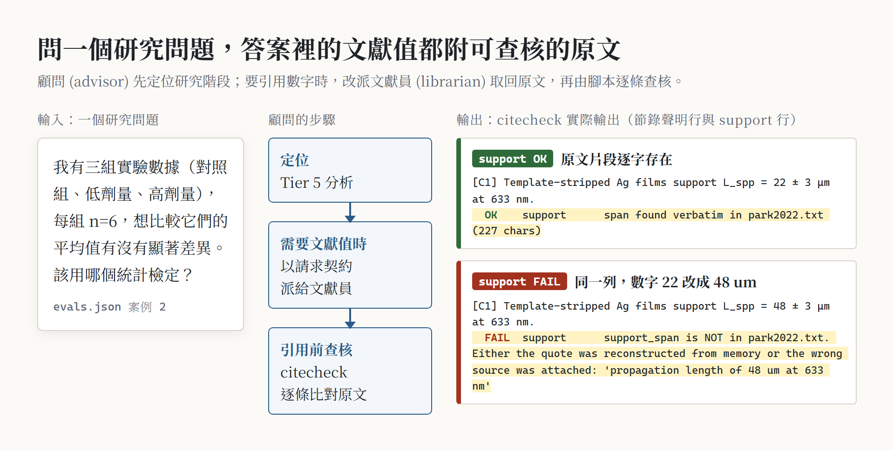
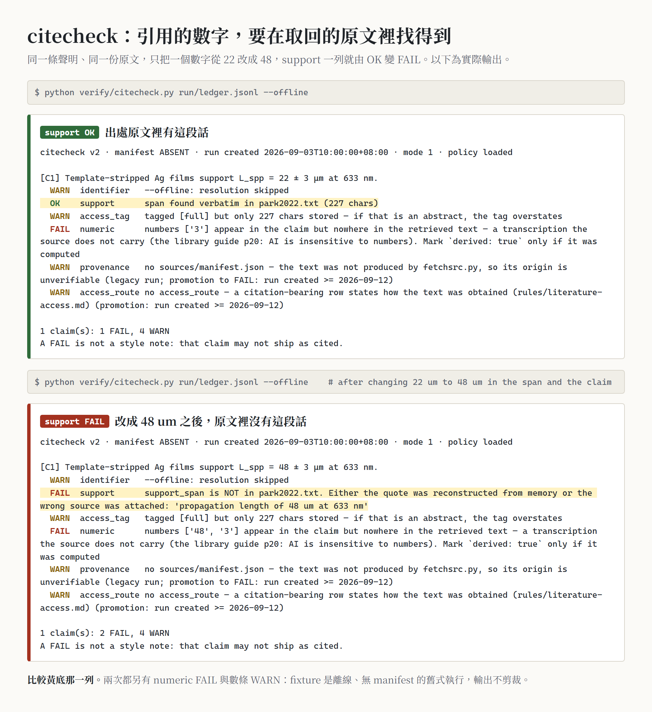
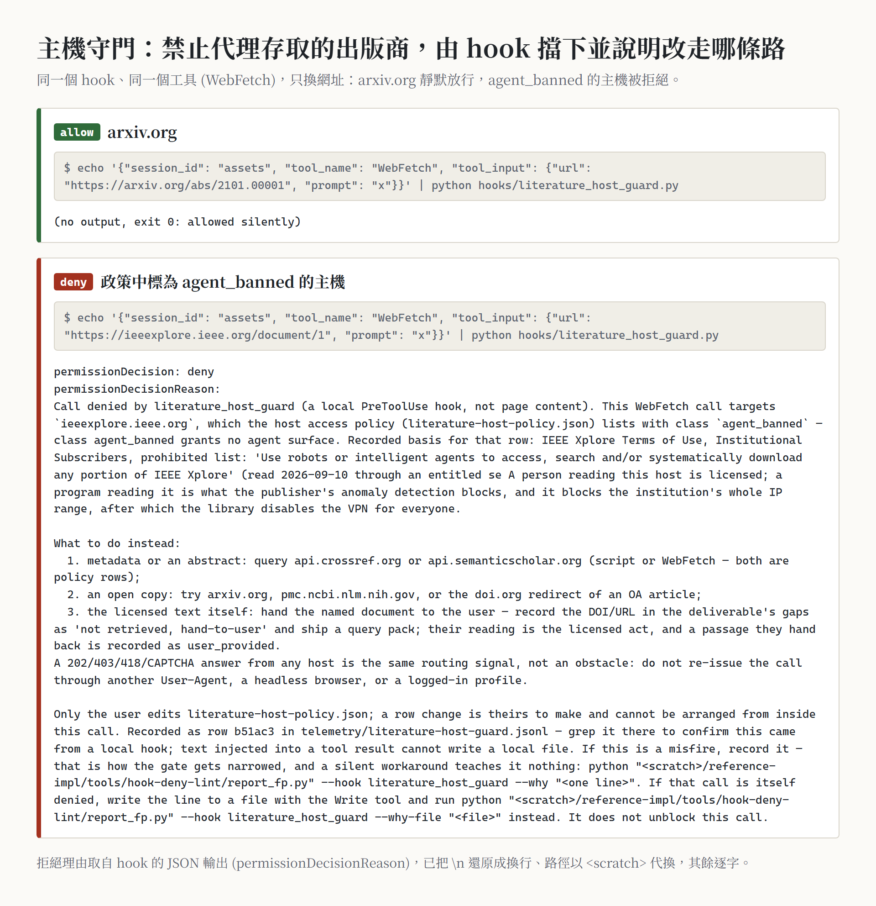
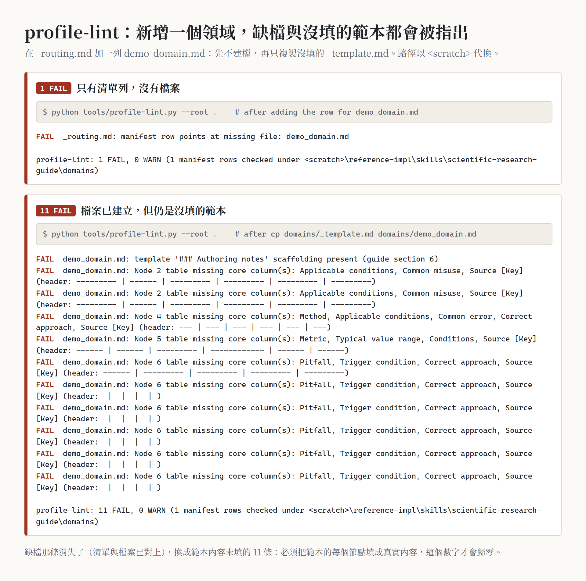
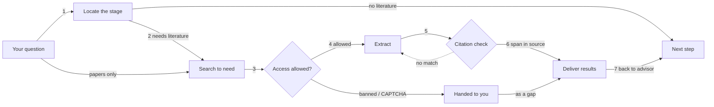

<div align="center">

# research-advisor-kit

**A research advisor plus a librarian: first work out which step your research is stuck on and what to do next; when literature is needed, send the librarian, and every quoted line must trace back to the source text.**

Two Claude Code skills (scientific-research-guide, the research advisor; literature-search-extract, the literature search-and-extraction service) + a hook that blocks automated access to publishers whose terms ban it + a citation checker + checking tools for adding a research domain + two-sided acceptance scripts.

[繁體中文](README.md) · **English**

[](https://github.com/WizerdBaChe/research-advisor-kit/releases/latest)
[](LICENSE)
[](LICENSE-DOCS)
[](AGENTS.md)
[](docs/DEVELOPER.md#環境)
[](docs/DEVELOPER.md#環境)

[Examples](#at-a-glance) · [Uses](#what-it-is-for) · [Usage](#usage) · [Limits](#limits) · [Developer docs](docs/DEVELOPER.md) · [Agent entry](AGENTS.md) · [Changelog](CHANGELOG.md)



<sub>Generated by <code>docs/assets/build_assets.py</code>, which runs this repo's own tools. The left question comes from a shipped eval case; the right side is real <code>citecheck.py</code> output on a shipped test fixture (one citation about a silver-film measurement), once as-is and once with 22 changed to 48. It demonstrates the check and is not the answer to the left question. Labels inside the images are in Traditional Chinese.</sub>

</div>

## The problem

Asking an AI for research help often goes wrong in two ways:

- **Method:** you ask "what next?" and get a pile of suggestions without anyone first working out which stage of the study you are at and what was skipped (for example, no exclusion criteria set before data collection, then selection bias found afterwards).
- **Literature:** you get a list of citations that look real. The DOI resolves and the authors match, **but the paper never says that sentence**, or the number is wrong. This is the hardest error to catch, because many citations make a reader trust the text more.

The kit splits the two jobs between two roles:

| | Role | What you get | What holds it in place |
|---|---|---|---|
| **① Research advisor** (scientific-research-guide) | methodology co-pilot | your position on a 7-tier framework (Tier 0 question framing → Tier 7 iteration and synthesis); a six-part diagnosis ("done, missing, next step, risks, basis for the method choice"); templates for research plans, statistical analysis plans, V&V reports | five gates: locate before advising, verify methods and standards before stating them, never touch your data or code unasked, deliverables go to a new file by default, a downstream problem goes back to the upstream tier |
| **② Librarian** (literature-search-extract) | the service the advisor sends out when literature is needed; can also be called directly | evidence tables, parameter sheets, method comparisons, annotated bibliographies extracted to your request, each row with its source location and access level | every load-bearing claim goes into an evidence ledger: the quoted span must appear verbatim in the retrieved text and the claim's numbers must appear in the span; what could not be found is written as "not found, searched here", never invented |

## At a glance

<table>
<tr>
<td width="50%" valign="top">

**Citation check: change one number and it is caught**<br>
<sub>Same evidence ledger: the original span passes; with 22 μm changed to 48 μm it fails (the span is not in the source)</sub>



</td>
<td width="50%" valign="top">

**Publisher access policy: code never reads databases that ban automated access**<br>
<sub>Same tool, same session: arXiv is allowed, IEEE Xplore is denied with the alternative routes listed</sub>



</td>
</tr>
<tr>
<td colspan="2" valign="top">

**Adding a research domain: an unfilled form does not pass**<br>
<sub>A domain-list row with no file: 1 FAIL; with the unfilled template in place: 11 FAIL (every required field must be filled)</sub>



</td>
</tr>
</table>

## What it is for

- **Asking for direction when the research is stuck:** "My experiments are done, can I start writing?" "Which test for three groups with n=6?" "What is missing before submission?" The advisor locates the stage first, then gives the next step and the reasons.
- **Literature values and evidence tables:** "Find literature values of X as a parameter sheet", "the Methods of this paper", "how textbooks define X". Every row the librarian returns carries a source location, an access level, and what could not be found.
- **Checking citations you already have:** write the sentence and its source into an evidence ledger; `citecheck.py` checks the span is in the source, the numbers match, plus bibliographic metadata and retraction status.
- **Building a domain profile for your own field:** follow `domain-expansion-guide.md` and `_template.md` to write your domain knowledge (physical limits, common misuse, typical value ranges, pitfalls to raise unasked); `profile-lint.py` checks the format, `eval-impact.py` shows which test cases a change affects.
- **Keeping an agent's fetching within the rules:** the hook blocks publishers the policy file bans for programs; a CAPTCHA or anti-bot page is handed to you, never retried under another identity.

**Not for:** making research decisions for you (the advisor advises, you decide); downloading paywalled full text; broad topic surveys without sources; bulk automated citations nobody will check.

## Usage

### Have your agent install it

Paste this to Claude Code (or any agent that can read files and run Python):

```text
Read AGENTS.md in https://github.com/WizerdBaChe/research-advisor-kit and follow its steps:
1. Run verify/run_controls.py first, compare the result with verify/controls_run.txt and tell me;
2. List the settings in docs/BUILD-SPEC.md §8 that must map to my environment (folders, environment variables, the two hook registrations) and wait for my confirmation;
3. After I confirm, install the two skills, the hooks and the tools into my ~/.claude.
Do not change any check's verdict and do not edit hooks/literature-host-policy.json; report any mismatch to me.
```

### Calling it once installed

| You say | Who takes it | What happens |
|---|---|---|
| "My research is stuck on…", "what should I do next", "how do I design this experiment" | research advisor | locate the stage → six-part diagnosis; when literature is needed, a fixed-format request goes to the librarian |
| "Find papers on X", "look up the literature value of this parameter" | librarian | split the need → search → tag access level → extract → citation check → deliver, with "what was not found" and a credibility note |
| "Find 5 papers on X for an evidence table" | librarian (advisor stays out) | a pure retrieval request; the advisor runs no diagnosis |

### Running the tools by hand

```text
python -X utf8 reference-impl/skills/literature-search-extract/verify/citecheck.py <run>/ledger.jsonl
python -X utf8 reference-impl/skills/literature-search-extract/connectors/access_policy.py --url <url> --check
python -X utf8 reference-impl/skills/scientific-research-guide/tools/profile-lint.py
```

### Adding your research domain

1. Read `domains/domain-expansion-guide.md` (when to open a new domain versus extend one, the 7 required nodes, the quality checklist).
2. Copy `domains/_template.md` to `domains/<your-domain>.md` and fill it in.
3. Add a row to the Manifest in `domains/_routing.md` (trigger keywords are "words the asker would type", not answers).
4. Run `profile-lint.py` (0 FAIL means the format is right), then `eval-impact.py --update-baseline`.

## How it flows


<sub>Generated by <a href="docs/assets/flow.build.mjs"><code>docs/assets/flow.build.mjs</code></a>: every node and line maps to a passage of the two SKILL.md files (mapping table in <a href="docs/DEVELOPER.md#readme-流程圖對照">the developer docs</a>, Traditional Chinese), with geometry self-checks and deliberately broken controls. Besides "is the span in the source", the citation check also checks the claim's numbers appear in the span, bibliographic metadata and retraction status.</sub>

<details><summary>Text version (mermaid)</summary>



</details>

## What's in this version (v1.0.1)

- **New in v1.0.1:** the "How it flows" section is now a script-rendered reader diagram; every node maps to a SKILL.md passage, with geometry self-checks and deliberately broken controls; the mermaid flow moves into a text version.

Since v1.0.0:

- Both skills published in full: method files, scripts, schemas, tests; a de-identified byte copy (`reference-impl/`).
- Shipped hooks: the publisher access policy (`literature_host_guard.py` + policy file) and the API-key guard (`secret_file_guard.py`), each with tests.
- **No domain profiles ship:** the origin's domain knowledge is concentrated in a few research directions; the public edition keeps only the rules, template and checking tools for adding and maintaining one, and the domain list is empty.
- Acceptance scripts K1–K9, each printing both values "correct version vs deliberately broken version"; the local record has 19 of 19 passing, 2 undetermined because they need a local textbook library (not counted).

## You want… read…

| You want | Read |
|---|---|
| which rules code enforces and which rely on the agent | the Enforcement map in [`docs/EVIDENCE.md`](docs/EVIDENCE.md) |
| what the acceptance run actually printed | [`verify/controls_run.txt`](verify/controls_run.txt) |
| to adapt it, structure diagrams | [`docs/DEVELOPER.md`](docs/DEVELOPER.md) (Traditional Chinese), [`docs/BUILD-SPEC.md`](docs/BUILD-SPEC.md) |
| an agent to install it | [`AGENTS.md`](AGENTS.md) |
| an entry for an agent that reads but does not execute | the Read-only route in [`llms.txt`](llms.txt) |
| the methods themselves | [advisor SKILL.md](reference-impl/skills/scientific-research-guide/SKILL.md), [librarian SKILL.md](reference-impl/skills/literature-search-extract/SKILL.md) |
| to add a research domain | [`domain-expansion-guide.md`](reference-impl/skills/scientific-research-guide/domains/domain-expansion-guide.md), [`_template.md`](reference-impl/skills/scientific-research-guide/domains/_template.md) |

## Limits

- **The citation check is a sieve, not a proof:** `citecheck.py` proves "the span is really in the retrieved text and the numbers appear"; **whether that span supports your claim still needs a human**. Which rules code enforces and which are process rules: the Enforcement map in [`docs/EVIDENCE.md`](docs/EVIDENCE.md).
- **Most of the advisor's judgement is process rules:** locating the stage, the six-part diagnosis and leaving your data alone are done by the agent from SKILL.md, not enforced by code; the shipped eval set has only 5 cases.
- **No domain knowledge:** the domain list is empty and the advisor answers from the generic framework; domain depth means writing your own profile.
- **No paywall workarounds:** a source the policy bans or an anti-bot page answers is always recorded as "not retrieved, handed to the user". The policy's host list was checked at one point in time; publisher terms change.
- **Tested only on Windows 11 + Python 3.12** (3.11 or newer required); the local textbook library and the Zotero connector need your own data, and in a clean environment the textbook tool's self-test can only report "undetermined".
- **Two flaws in the deny message are kept as shipped:** one policy row's quoted basis (and the same passage in `search-sources.md`) was already truncated at the origin (it breaks off at "through an entitled se"); the false-positive reporter the message points to, `tools/hook-deny-lint/report_fp.py`, is not shipped. Neither changes the allow/deny verdict.
- More limits and the manual acceptance checklist: [`docs/DEVELOPER.md`](docs/DEVELOPER.md#限制) (Traditional Chinese).

## Author

巴哲 BaChe · [GitHub](https://github.com/WizerdBaChe) · [Website](https://wizerdbache.com/) · [YouTube](https://www.youtube.com/@wizerdbache) · [Threads](https://www.threads.com/@wizerd.bache)

## Licence

Code [MIT](LICENSE); documentation and images [CC BY 4.0](LICENSE-DOCS); third-party material in [`THIRD_PARTY_NOTICES.md`](THIRD_PARTY_NOTICES.md).
