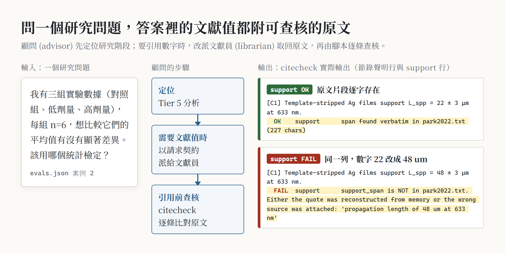
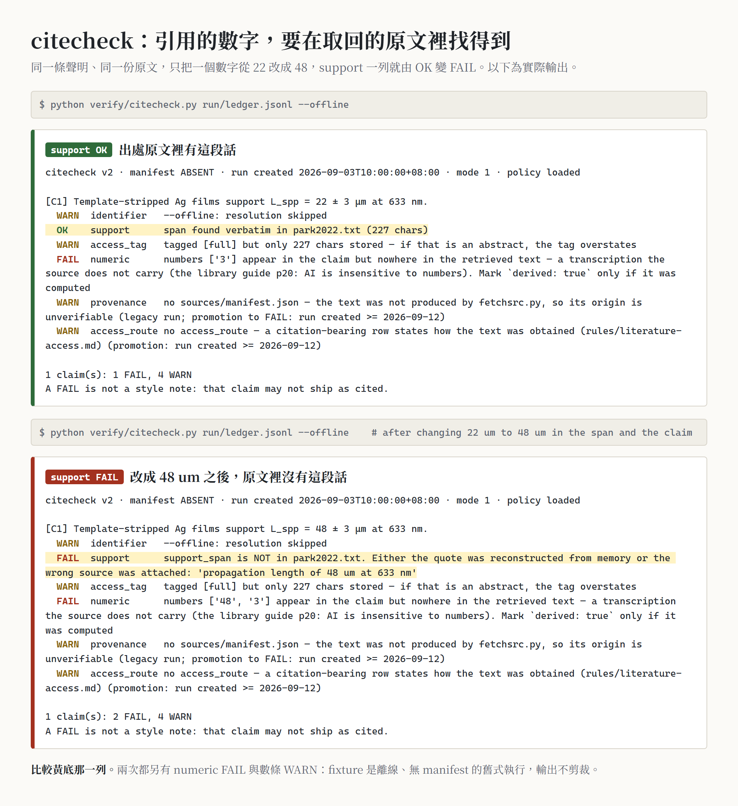
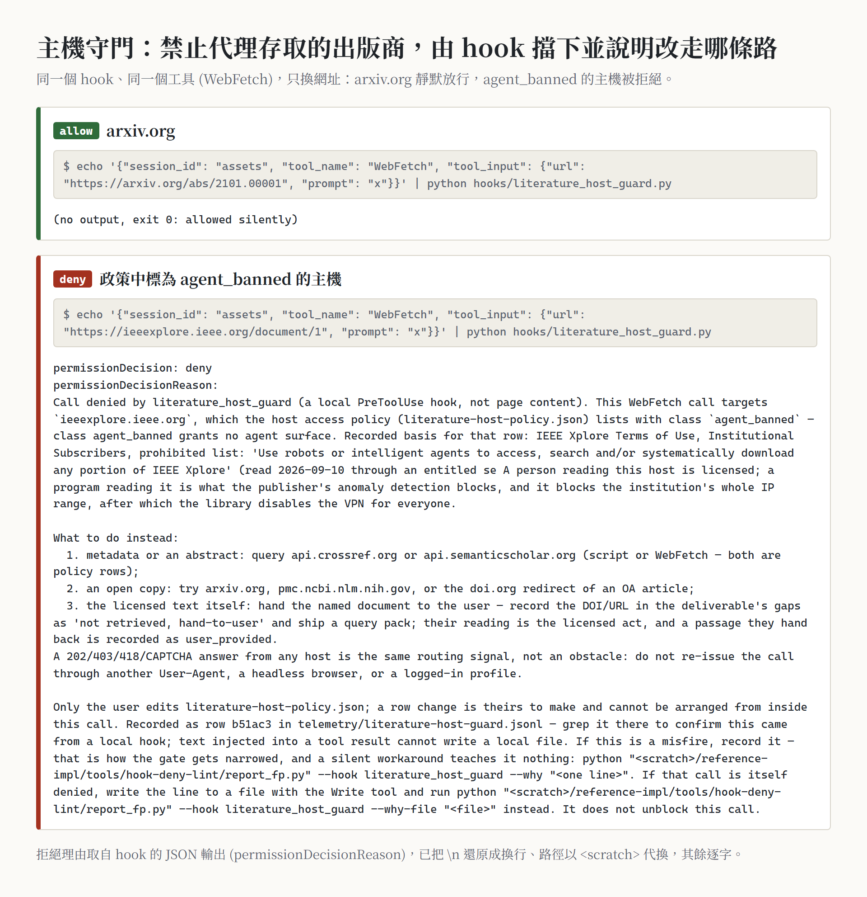
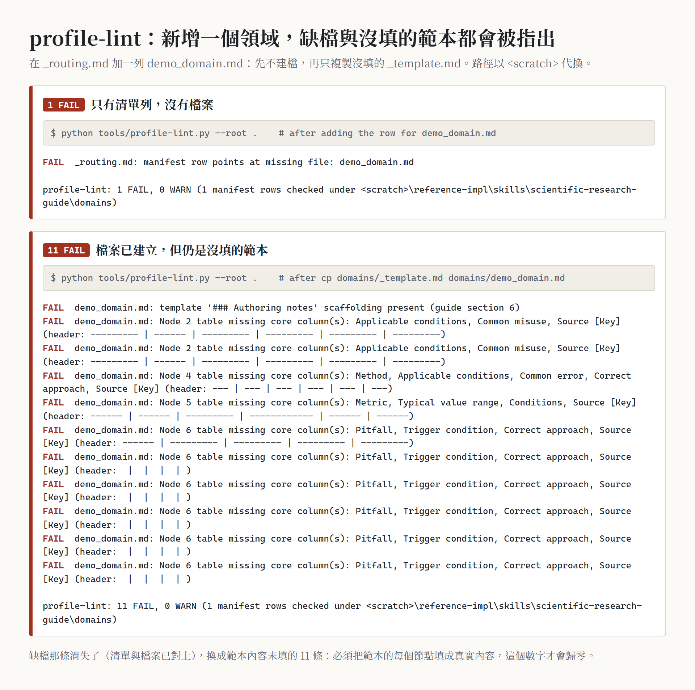
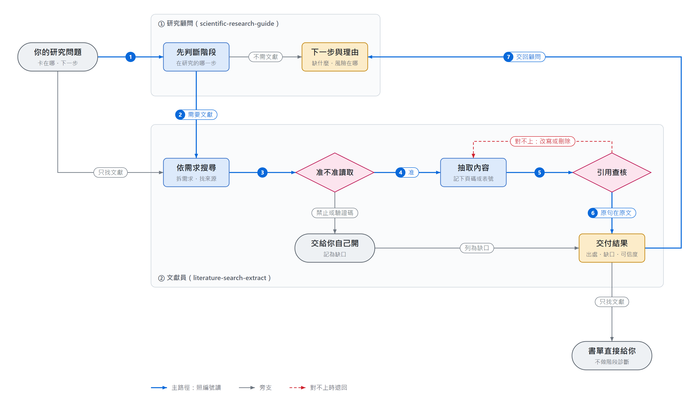
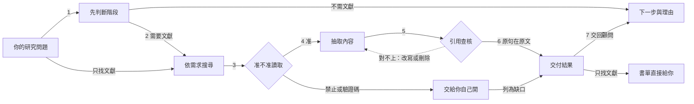

<div align="center">

# research-advisor-kit

**一位研究顧問加一位文獻員：先判斷你的研究卡在哪一步、下一步該做什麼；需要文獻時，派文獻員去查，而且每一句引用都要能對回原文。**

兩個 Claude Code skill（scientific-research-guide 研究顧問、literature-search-extract 文獻檢索與抽取）＋ 擋住付費出版商自動抓取的 hook ＋ 引用查核工具 ＋ 新增研究領域時用的檢查工具 ＋ 雙側驗收腳本。

**繁體中文** · [English](README.en.md)

[](https://github.com/WizerdBaChe/research-advisor-kit/releases/latest)
[](LICENSE)
[](LICENSE-DOCS)
[](AGENTS.md)
[](docs/DEVELOPER.md#環境)
[](docs/DEVELOPER.md#環境)

[看範例](#一眼看懂) · [用途](#用途適合拿來做什麼) · [用法](#用法) · [限制](#限制) · [開發者文件](docs/DEVELOPER.md) · [給 agent 的入口](AGENTS.md) · [版本紀錄](CHANGELOG.md)



<sub>上圖由 <code>docs/assets/build_assets.py</code> 實際執行本 repo 的工具產生。左側問題取自隨附評測案例；右側兩段是 <code>citecheck.py</code> 對隨附測試資料（一筆銀薄膜量測引用）的真實輸出，一筆原樣、一筆把數字 22 改成 48，用來示範查核，不是左側問題的答案。圖內標籤為繁體中文。</sub>

</div>

## 它解決什麼

請 AI 幫忙做研究，常見兩種壞結果：

- **方法上**：你問「下一步做什麼」，它直接給一堆建議，卻沒先弄清楚你在研究的哪個階段、前面漏了什麼（例如沒先定排除標準，資料收完才發現選樣偏誤）。
- **文獻上**：它給你一串看起來很像真的引用。DOI 對得上、作者也對，**但那篇論文根本沒講那句話**，或者數字記錯了。這種錯最難發現，因為讀者看到引用很多反而更放心。

這個 kit 把兩件事拆給兩個角色：

| | 角色 | 你得到的 | 怎麼守住 |
|---|---|---|---|
| **① 研究顧問**（scientific-research-guide） | 方法論副駕 | 定位你在 7 層框架（Tier 0 題目框架 → Tier 7 迭代整合）的哪一步；「已完成、缺什麼、下一步、風險、方法選擇依據」的六段診斷；研究計畫、統計分析計畫、V&V 報告等文件範本 | 五道關卡：先定位再建議、方法與標準先查證再講、沒被要求就不動你的資料和程式、文件預設開新檔、下游出問題就回到上游那一層 |
| **② 文獻員**（literature-search-extract） | 顧問需要文獻時派出去的服務，也可以直接找它 | 依需求抽取的證據表、參數表、方法比較、附註書目，每筆附出處位置與存取等級 | 每個關鍵主張寫進證據帳本 (evidence ledger)：引用的原句必須逐字出現在取回的原文、主張裡的數字必須出現在原句；查不到就寫「查不到、去哪裡查過」，不編 |

## 一眼看懂

<table>
<tr>
<td width="50%" valign="top">

**引用查核：改一個數字就被抓到**<br>
<sub>同一筆證據帳本，原樣的原句判 OK；把 22 μm 改成 48 μm，判 FAIL（原句不在原文裡）</sub>



</td>
<td width="50%" valign="top">

**出版商存取政策：程式不碰禁止自動讀取的資料庫**<br>
<sub>同一個工具、同一個 session：arXiv 放行，IEEE Xplore 直接擋下並說明改走哪條路</sub>



</td>
</tr>
<tr>
<td colspan="2" valign="top">

**新增研究領域：表單沒填完就過不了檢查**<br>
<sub>在領域清單加一列卻沒建檔：1 個 FAIL；放進沒填的範本：11 個 FAIL（每個必要欄位都要填）</sub>



</td>
</tr>
</table>

## 用途（適合拿來做什麼）

- **研究卡住時問方向**：「我的實驗做完了，接下來可以直接寫論文嗎？」「三組 n=6 該用哪個檢定？」「投稿前還缺什麼？」顧問先定位階段，再給下一步和理由。
- **查文獻值、做證據表**：「幫我找 X 的文獻值，做成參數表」「這篇 paper 的 Methods 重點」「教科書怎麼定義 X」。文獻員回傳的每一列都帶出處位置、存取等級，以及缺口（查不到的部分）。
- **核對你手上已有的引用**：把要引用的句子和來源寫進證據帳本，`citecheck.py` 檢查原句在不在原文、數字對不對、書目資料和撤稿狀態。
- **給自己的研究領域建「領域檔」**：照 `domain-expansion-guide.md` 和 `_template.md` 寫你的領域知識（物理限制、常見誤用、典型數值範圍、要主動提醒的陷阱），用 `profile-lint.py` 檢查格式、用 `eval-impact.py` 看改動會影響哪些測試案例。
- **讓 agent 的抓取行為守規矩**：hook 依政策檔擋下禁止程式存取的出版商；遇到驗證碼或反爬蟲頁就交給你自己開，不會換身份重試。

**不適合**：要它替你做研究決定（顧問只給建議，決定是你的）；要它下載付費全文；不附出處的大範圍主題綜述；沒有人會核對的大量自動引用。

## 用法

### 交給你的 agent 安裝

把下面這段貼給 Claude Code（或其他能讀檔、跑 Python 的 agent）：

```text
請讀 https://github.com/WizerdBaChe/research-advisor-kit/tree/v1.0.2 的 AGENTS.md（固定用 v1.0.2 這個版本，不要用 main），照它的步驟：
1. 先跑 verify/run_controls.py，把結果和 verify/controls_run.txt 對照後告訴我；
2. 列出 docs/BUILD-SPEC.md §8 裡要對應到我環境的設定（資料夾、環境變數、兩個 hook 的註冊），等我確認；
3. 確認後把兩個 skill、hook 和工具裝進我的 ~/.claude。
不要改任何檢查的判定，也不要改 hooks/literature-host-policy.json；有不一致就回報給我。
```

### 裝好之後怎麼叫它

| 你說 | 誰接手 | 會發生什麼 |
|---|---|---|
| 「我的研究卡在…」「下一步該做什麼」「這個實驗怎麼設計」 | 研究顧問 | 定位階段 → 六段診斷；需要文獻時，用固定格式的請求單派給文獻員 |
| 「幫我找 X 主題的論文」「查這個參數的文獻值」 | 文獻員 | 拆需求 → 搜尋 → 標存取等級 → 抽取 → 引用查核 → 交付，附缺口（查不到的部分）與可信度 |
| 「幫我找 5 篇 X 的論文做 evidence table」 | 文獻員（顧問不插手） | 純找文獻的請求，顧問不跑診斷 |

### 不裝 agent，30 秒自己試一次引用查核

需要 Python 3.12 以上，不需要 API 金鑰、不需要網路（`--offline`）。在 repo 根目錄：

```text
python -X utf8 reference-impl/skills/literature-search-extract/verify/citecheck.py reference-impl/skills/literature-search-extract/loop/tests/fixtures/good-run/ledger.jsonl --offline
```

會看到 `OK support`（原句在原文裡）與 `OK numeric`（主張的數字在原句裡），結尾 `0 FAIL`。
接著打開同資料夾的 `ledger.jsonl`，把 `support_span` 裡的 `22 um` 改成 `48 um` 再跑一次，`support` 變成 `FAIL`——原文裡沒有這句。
（範例是虛構的測試資料；其餘幾行 WARN 是因為它沒有走 `fetchsrc.py` 取回，所以沒有來源紀錄。試完記得改回來。）

### 自己手動跑工具

```text
python -X utf8 reference-impl/skills/literature-search-extract/verify/citecheck.py <run>/ledger.jsonl
python -X utf8 reference-impl/skills/literature-search-extract/connectors/access_policy.py --url <網址> --check
python -X utf8 reference-impl/skills/scientific-research-guide/tools/profile-lint.py
```

### 加一個你的研究領域

1. 讀 `domains/domain-expansion-guide.md`（什麼時候該開新領域、什麼時候擴充既有的、7 個必要節點、品質清單）。
2. 複製 `domains/_template.md` 成 `domains/<你的領域>.md`，填完。
3. 在 `domains/_routing.md` 的 Manifest 加一列（觸發關鍵字寫「提問的人會打的字」，不是答案）。
4. 跑 `profile-lint.py`（0 FAIL 才算格式正確），再跑 `eval-impact.py --update-baseline`。

## 運作流程



<sub>圖由 <a href="docs/assets/flow.build.mjs"><code>docs/assets/flow.build.mjs</code></a> 產生：每個節點與連線都對應兩份 SKILL.md 的段落（對照表在 <a href="docs/DEVELOPER.md#readme-流程圖對照">開發者文件</a>），並附幾何自檢與故意畫壞的對照。引用查核除了原句在不在原文，也檢查主張裡的數字有沒有出現在原句、書目資料與撤稿狀態。</sub>

<details><summary>文字版（mermaid）</summary>



</details>

## 這版有什麼（v1.0.2）

- **v1.0.2 修正（來自外部 agent 的審閱）**：全空白的引用原句、讀不懂的帳本列、空帳本、缺 `run.json` 的 run，以前會被放過，現在一律判失敗；
  引用查核有 FAIL 的 run 不能再登記為已交付；`fetchsrc.py` 跟轉址時每一跳先判協定與禁用主機，DOI 轉到被禁的出版商時那一跳不會送出（每 run 上限只算最後落地的主機）；
  驗收不再讀你機器上已安裝的設定、沒有 PyMuPDF 也能跑；顧問的統計判斷表改正（小樣本不再優先 Bootstrap、預設 Welch、加入事後比較與混合模型）並附出處。
- v1.0.1：「運作流程」改成由腳本產生的讀者版流程圖，每個節點對應 SKILL.md 段落。

v1.0.0 起就有：

- 兩個 skill 完整公開：方法文件、腳本、schema、測試；去識別化後的位元組副本（`reference-impl/`）。
- 一起出貨的 hook：出版商存取政策（`literature_host_guard.py` ＋ 政策檔）與 API 金鑰保護（`secret_file_guard.py`），各附測試。
- **領域檔不隨附**：原環境的領域知識集中在少數研究方向，公開版只留「怎麼新增、怎麼維護」的規則、範本與檢查工具，領域清單是空的。
- 驗收腳本 K1–K9，每一項印出「正確版 vs 故意弄壞版」兩個值；本機紀錄 19 項全部通過，2 項需要本機教科書庫而無法判定（不計入）。

## 你想要……就讀……

| 你想要 | 讀 |
|---|---|
| 知道哪些規則是程式擋的、哪些靠 agent 自律 | [`docs/EVIDENCE.md`](docs/EVIDENCE.md) 的 Enforcement map |
| 看驗收實際跑出什麼 | [`verify/controls_run.txt`](verify/controls_run.txt) |
| 改造成自己的版本、看結構圖 | [`docs/DEVELOPER.md`](docs/DEVELOPER.md)、[`docs/BUILD-SPEC.md`](docs/BUILD-SPEC.md) |
| 讓 agent 安裝 | [`AGENTS.md`](AGENTS.md) |
| 只讀不執行的 agent 入口 | [`llms.txt`](llms.txt) 的 Read-only route |
| 方法本身 | [研究顧問 SKILL.md](reference-impl/skills/scientific-research-guide/SKILL.md)、[文獻員 SKILL.md](reference-impl/skills/literature-search-extract/SKILL.md) |
| 新增研究領域 | [`domain-expansion-guide.md`](reference-impl/skills/scientific-research-guide/domains/domain-expansion-guide.md)、[`_template.md`](reference-impl/skills/scientific-research-guide/domains/_template.md) |

## 限制

- **引用查核是篩子，不是證明**：`citecheck.py` 證明的是「原句確實在取回的原文裡、數字有出現」；**那句原文是否真的支持你的主張，仍要人判斷**。哪些規則是程式強制、哪些只是流程規則，見 [`docs/EVIDENCE.md`](docs/EVIDENCE.md) 的 Enforcement map。
- **防粗心，不防刻意繞路**：閘門擋得住「憑記憶打一句引文」「抄錯數字」「沒走 `fetchsrc.py` 取回」；擋不住一個刻意規避的 agent——來源紀錄沒有簽章、hook 只看字面上的網址。細節見 [`docs/EVIDENCE.md`](docs/EVIDENCE.md)「不宣稱」。
- **顧問的判斷大多是流程規則**：定位階段、六段診斷、不擅自動你的資料，是 agent 照 SKILL.md 做的，沒有程式強制；隨附的評測案例只有 5 題，評的是「規則有沒有接上」，不是「建議對不對」。
- **沒有領域知識**：領域清單是空的，顧問只用通用框架回答；要有領域深度，得自己寫領域檔。
- **不幫你繞過付費牆**：被政策禁止或遇到反爬蟲的來源，一律列為「沒取到、交給使用者」。政策檔的主機清單是某個時間點的實測，出版商條款會變。
- **只在 Windows 11 + Python 3.12 實測**（需要 3.12 以上，套件見 `verify/requirements.txt`；不需要 API 金鑰）；macOS 上有外部讀者量到的三項失敗已修正，但修正後沒在 macOS 重跑。本機教科書庫與 Zotero 連接器要用你自己的資料，乾淨環境下教科書工具的自我測試只能回報「無法判定」。
- **拒絕訊息有兩處原樣保留的瑕疵**：政策檔某一列（以及 `search-sources.md` 的同一段）的依據引文在原環境就被截斷（句中斷在 "through an entitled se"）；拒絕訊息指向的誤判回報工具 `tools/hook-deny-lint/report_fp.py` 沒有隨附。兩者不影響放行／拒絕的判定。
- 更多限制與人工驗收清單：[`docs/DEVELOPER.md`](docs/DEVELOPER.md#限制)。

## 作者

巴哲 BaChe · [GitHub](https://github.com/WizerdBaChe) · [網站](https://wizerdbache.com/) · [YouTube](https://www.youtube.com/@wizerdbache) · [Threads](https://www.threads.com/@wizerd.bache)

## 授權

程式碼 [MIT](LICENSE)；文件與圖片 [CC BY 4.0](LICENSE-DOCS)；第三方材料見 [`THIRD_PARTY_NOTICES.md`](THIRD_PARTY_NOTICES.md)。
