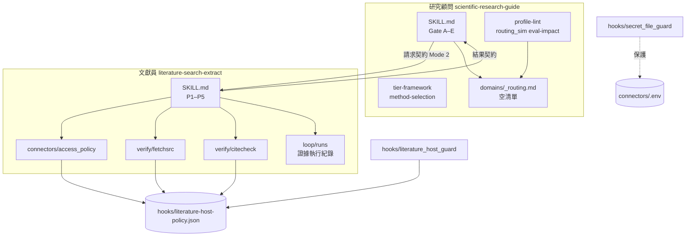
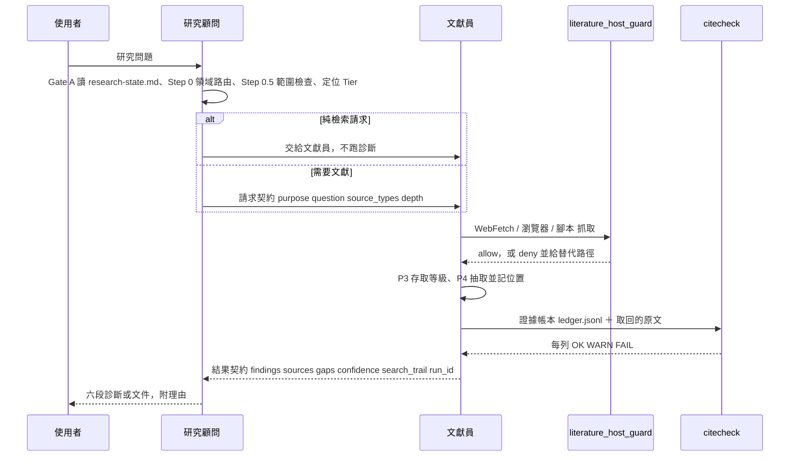

# 開發者說明（DEVELOPER）

給要改造、重建或審查這個 kit 的人。給 agent 的安裝步驟在 [`AGENTS.md`](../AGENTS.md)，規格在 [`BUILD-SPEC.md`](BUILD-SPEC.md)，哪些規則有程式強制在 [`EVIDENCE.md`](EVIDENCE.md)。

`reference-impl/` 是原環境 `~/.claude` 的位元組副本 (byte copy)，只套用 [`BUILD-SPEC.md`](BUILD-SPEC.md) §9 列出的宣告修改；不要手改裡面的檔案，改動應該回到原環境再重新產生。

## 結構樹

```text
research-advisor-kit/
├── README.md / README.en.md / AGENTS.md / llms.txt
├── docs/
│  ├── BUILD-SPEC.md      規格（英文，給 agent 執行）
│  ├── EVIDENCE.md        量測結果、來源紀錄、Enforcement map
│  ├── DEVELOPER.md       本檔
│  └── assets/            README 圖片與重產腳本 build_assets.py
├── verify/
│  ├── run_controls.py    雙側驗收 K1–K9
│  ├── controls_run.txt   本機驗收紀錄
│  ├── fresh_clone_run.txt 乾淨 clone 驗收紀錄
│  ├── host.toml          乾淨環境用的機器根目錄設定（全部 none）
│  └── unshipped_paths.txt 刻意不出貨的原環境路徑與原因
└── reference-impl/       對應 ~/.claude 的目錄結構
   ├── hooks/
   │  ├── literature_host_guard.py   出版商存取政策 hook
   │  ├── literature-host-policy.json 主機政策（hook 與文獻員共用）
   │  ├── secret_file_guard.py       API 金鑰讀取保護 hook
   │  ├── deny_receipt.py            拒絕紀錄與誤擋回報
   │  ├── _lib/roots.py, telemetry.py 機器根目錄、加鎖寫入
   │  └── tests/test_literature_host_guard.py
   ├── rules/literature-access.md    存取規則（hook 執行的那條規則的文字版）
   ├── tools/secret-guard-test/      secret_file_guard 的測試
   └── skills/
      ├── scientific-research-guide/ 研究顧問
      │  ├── SKILL.md
      │  ├── references/  tier-framework、method-selection、deliverables、user-supplied-citations
      │  ├── domains/     _routing.md（空清單）、_template.md、domain-expansion-guide.md
      │  ├── tools/       profile-lint、routing_sim、eval-impact、profile_frontmatter
      │  └── evals/       5 個評測案例、路由基準、lint 用的兩組故意弄壞的範例
      └── literature-search-extract/ 文獻員
         ├── SKILL.md
         ├── references/  搜尋來源、連接器、可信度評分、抽取手冊、查核閘、回饋迴路、輸出範本…
         ├── connectors/  access_policy、probe、zotero_local、pdf_index、textbook_index/ocr、local_find
         ├── verify/      citecheck、fetchsrc、pagestore、spannorm、staleclaim
         ├── loop/        runs、inbox、reflux、idkey（證據執行紀錄的存放與回流）＋測試
         ├── consumers/   呼叫者登記表
         └── evals/       評測案例
```

## 元件圖



三個讀者共用一份政策檔：hook 在工具層擋，`access_policy.py` 在路由時查，`fetchsrc.py` 在每次抓取前查並計次，`citecheck.py` 檢查每筆證據的取得路徑。政策只有一份，所以 skill 和 hook 不會對同一台主機做出不同判斷。

## 工作流程圖



## README 流程圖對照

README 的「運作流程」是給第一次看的人的簡化圖（自動排版，位置不代表任何意義）。每個節點對應的原始段落：

| 圖上節點 | 對應 | 省略了什麼 |
|---|---|---|
| 研究顧問 先判斷你在哪個階段 | 研究顧問 SKILL.md Gate A（Step 0、0.5、1） | Gate B–E、research-state.md |
| 下一步與理由 | Gate A 六段診斷 | 文件範本（Gate D） |
| 文獻員 依需求搜尋 | 文獻員 SKILL.md Mode 1 / Mode 2、P1–P2 | 召回檢查、連接器路由 |
| 這個出版商准不准程式讀取 | `literature-host-policy.json`、`access_policy.py`、`literature_host_guard.py` | 每主機與每次執行的次數上限 |
| 交給你自己開 | P3 hand-to-user、`rules/literature-access.md` 第 5 步 | — |
| 抽取內容 | P3 存取等級、P4 抽取 | 衝突並列、限制條件抽取 |
| 引用查核 | P4.5、`verify/citecheck.py` | 書目比對、撤稿、取得路徑檢查 |
| 照原文改寫主張或刪掉 | `references/verification-gate.md` 修復順序 | 其餘五種修復 |
| 交付結果 | P5 結果契約 | AI 使用揭露、Zotero 收尾 |

## 模組對照

| 你要改的 | 檔案 | 改完跑 |
|---|---|---|
| 研究階段框架、方法選擇 | `references/tier-framework.md`、`method-selection.md` | 研究顧問評測案例（`evals/evals.json` 的 run.method，人工評分） |
| 新增研究領域 | `domains/_routing.md`、`_template.md`、`domain-expansion-guide.md` | `profile-lint.py`、`eval-impact.py --update-baseline` |
| 引用查核規則 | `verify/citecheck.py`、`spannorm.py` | `citecheck.py --selftest --offline` |
| 抓取與次數上限 | `verify/fetchsrc.py`、`connectors/access_policy.py` | 兩者的 `--selftest` |
| 出版商主機政策 | `hooks/literature-host-policy.json`（使用者的檔案） | `hooks/tests/test_literature_host_guard.py`、`access_policy.py --selftest` |
| 證據執行紀錄 | `loop/runs.py`、`inbox.py`、`reflux.py`、`idkey.py` | 各自 `--selftest`、`pytest loop/tests` |
| 金鑰保護 | `hooks/secret_file_guard.py` | `tools/secret-guard-test/test_secret_file_guard.py` |

## 環境

- 實測：Windows 11、Python 3.12.7、pytest 9.1.1、idutils 1.7.0、jsonschema 4.26.0。需要 Python 3.11 以上（`roots.py` 用 `tomllib`）；`idutils` 與 `jsonschema` 是驗收 K1e、K1h、K2 的必要套件。
- 選用：PyMuPDF（讀 PDF 文字）、Zotero 本機資料庫、本機教科書庫；驗收不需要。
- 機器根目錄由 `hooks/_lib/roots.py` 讀 `host.toml`（或環境變數 `HK_HOST_TOML` 指向的檔案）；乾淨環境用 `verify/host.toml`，所有選用根目錄都是 none。
- 證據執行紀錄的位置：`LSE_RUN_HOME`、`LSE_INBOX`、`LSE_BIB_HOME`，沒設時用 host.toml 的 `NOTES_VAULT/literature/…`，兩者都沒有就停下來要你設定。
- arXiv 禮貌性聯絡信箱：`LSE_ARXIV_CONTACT`，預設空白（不送任何聯絡資訊）。

## 怎麼驗證

```text
python -X utf8 verify/run_controls.py <新的空資料夾>
```

每一行要以 `-> ok` 結尾，並印出「正確版 vs 弄壞版」兩個值；`UNDT` 兩行是需要本機教科書庫的工具，在乾淨環境只能回報無法判定，不計入。紀錄在 `verify/controls_run.txt`（本機）與 `verify/fresh_clone_run.txt`（乾淨 clone）。

## 刻意的設計

- **兩個角色、一份契約**：顧問只做方法判斷，不自己搜文獻；文獻員只回報來源說了什麼，不替使用者下結論。兩者之間是固定欄位的請求單與結果單，所以顧問可以檢查文獻員交回來的東西缺什麼。
- **原句要能被程式找到**：證據帳本每列都要寫出主張所依據的「原句」。程式判斷不了「支不支持」，但能證明原句真的在原文裡；這讓「引用了真的論文、但論文沒講那句話」這種錯變成可以被抓到的。
- **查不到也是一種主張**：回報「找不到」之前，要先拿一篇已知存在的相關文獻測試查詢本身找不找得到它（召回檢查）。
- **政策是一份檔案，不是三份記憶**：hook、路由、抓取、查核都讀同一份政策檔；遇到反爬蟲頁是「交給使用者」的訊號，不是要想辦法繞過的障礙。
- **領域知識是外掛**：顧問的通用框架（Layer A）不因領域而改；領域檔（Layer B）由清單決定什麼時候載入，清單是唯一的載入來源，所以加領域只動清單和新檔。

## 限制

- `citecheck.py` 是篩子：證明原句在原文、數字在原句、書目一致；**不證明原句支持主張**。
- 研究顧問的五道關卡、六段診斷、不擅自動資料，都是 agent 依 SKILL.md 文字執行的流程規則，沒有程式強制；隨附評測只保留 5 個與領域無關的案例。
- 沒有隨附任何領域檔；領域相關的陷阱提醒、典型數值範圍要自己寫。
- 政策檔的主機分類是某個時間點的實測與條款閱讀，出版商條款會變；`institutional_only` 這類列只對原環境的訂閱有效。
- hook 只看得到工具呼叫的參數：一支自己寫的腳本若在 hook 看不到的地方抓取，只會被 `fetchsrc.py` / `access_policy.py --record` 計次（如果有用它們）。
- `textbook_ocr.py --selftest` 在沒有教科書庫的機器上回傳 exit 1，而不是像 `local_find.py` 回報「無法判定」（原環境既有行為，驗收時列為 UNDT）。
- 只在 Windows 11 實測；macOS / Linux 未跑過驗收。
- `literature-host-policy.json` 中 IEEE Xplore 那列的依據引文在原環境就被截斷（斷在 "through an entitled se"）；政策檔是使用者自己維護的檔案，公開版原樣保留，不代改。
- 拒絕訊息指向的誤判回報工具 `tools/hook-deny-lint/report_fp.py` 沒有隨附；要回報誤判，自己記一行到 hook 的 telemetry 即可。
- `rules/literature-access.md` 說次數上限「刻意不放在 hook 裡」，但目前的 hook 已對 `max_per_run` ≤ 2 的主機做單一 session 計次，並對未登記的抓取腳本發提醒；規則文字落後於 hook（原環境既有）。
- hook 會擋下「指令文字裡只是出現」禁止主機網址的 Bash 呼叫（例如把網址當測試字串），這是原環境既有的誤判；驗收腳本用字串拼接避開。

## 人工驗收

### A 必驗

1. 在乾淨 clone 跑 `verify/run_controls.py`，19 行都是 `-> ok`，兩行 UNDT。
2. 照 AGENTS.md 裝進另一台機器的 `~/.claude`，在 `settings.json` 註冊兩個 hook 後，讓 agent 用 WebFetch 讀一個 IEEE Xplore 網址：要被擋下，並看到改走哪條路的說明。
3. 對研究顧問說「我有三組實驗數據（對照組、低劑量、高劑量），每組 n=6，該用哪個統計檢定？」：回答要先定位到分析階段，再依資料型態與前提給出檢定與理由，而不是直接丟一個名字。
4. 對文獻員說「幫我找 X 的文獻值做成參數表」（X 換成你熟的主題）：每一列都有出處位置與存取等級，結尾有「查不到的部分」與可信度。
5. 把其中一列的數字改掉後跑 `citecheck.py`：那一列要變成 FAIL。
6. 照 `domain-expansion-guide.md` 加一個你的領域，`profile-lint.py` 跑到 0 FAIL；再問一個含該領域關鍵字的問題，顧問要說明它載入了哪個領域檔。

### B 體驗

1. 六段診斷讀起來像有經驗的學長姐在指路，而不是一份清單。
2. 文獻員遇到付費牆時給的「交給你」清單（DOI、網址、查詢詞）可以直接拿去圖書館用。
3. 研究顧問不會在你只想找文獻時插進一大段診斷。

## 重產 README 圖片

```text
python -X utf8 docs/assets/build_assets.py
```

腳本把 `reference-impl/` 複製到暫存資料夾，實際執行 `citecheck.py`、`literature_host_guard.py`、`profile-lint.py`，把輸出貼進 `docs/assets/src/` 的頁面再截圖。需要 `playwright` 與 Chromium（`python -m playwright install chromium`）。
